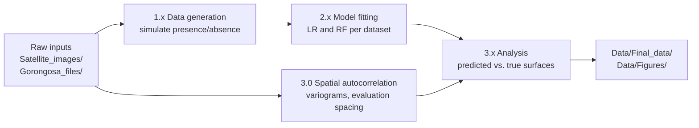

# Machine learning for habitat selection: a simulation study

**MSc thesis, Chapter 2 · University of the Witwatersrand**

This repository holds the R code for a simulation study that compares **logistic regression (LR)** and **random forest (RF)** models for habitat selection. Presence/absence data are simulated across Gorongosa National Park, Mozambique, from real environmental predictors under three response surfaces that are progressively more non-linear. Because the generating ("true") probability surface is known, each model's predictions can be checked directly against the truth.

> **Hypothesis:** as the species–environment relationship becomes more non-linear, RF's predictive performance should improve relative to LR.

---

## Contents

- [Study design](#study-design)
- [Workflow](#workflow)
- [Simulation scenarios](#simulation-scenarios)
- [Script reference](#script-reference)
- [Repository structure](#repository-structure)
- [Getting started](#getting-started)
- [Reproducibility notes](#reproducibility-notes)
- [Dependencies](#dependencies)
- [Citation and contact](#citation-and-contact)

---

## Study design

| Component | Details |
|---|---|
| Study area | Gorongosa National Park, Mozambique |
| Predictors | NDVI, LAI, distance to water, percent tree cover (PTC) |
| Scenarios | Linear, semi-non-linear, non-linear |
| Replicates | 200 simulated datasets per scenario |
| Candidate locations | Pool of 20,000 locations, shared across scenarios (seed `3791`) |
| Models | Logistic regression (scaled predictors); random forest (`ranger`, tuned over a hyperparameter grid) |
| Primary metrics (vs. truth) | RMSE, bias, and correlation between predicted and true probabilities |
| Secondary metrics | AUC, TSS, sensitivity, specificity |
| Spatial checks | Variogram-based estimates of predictor autocorrelation range, used to set the spacing of evaluation points |

The primary metrics are the point of the study: they compare predictions with the known generating surface, which is only possible with simulated data. AUC and TSS are reported as well so that results can be compared with the thesis's empirical case-study chapter, where the true surface is unknown.

---

## Workflow



Each scenario (linear `x.1`, semi-non-linear `x.2`, non-linear `x.3`) runs through the same three stages: **generate → fit → evaluate**.

---

## Simulation scenarios

In all three scenarios the observed response at location $i$ is drawn as

$$\Large{y_i \sim \text{Bernoulli}(p_i)}$$

The scenarios differ only in how $\text{logit}(p_i)$ depends on the four predictors.

### 1. Linear

$$\Large{y_i \sim \text{Bernoulli}(p_i)}$$
$$\Large{\text{logit}(p_i) = \alpha + \beta_{1}X_{1i} + \beta_{2}X_{2i} + \beta_{3}X_{3i} + \beta_{4} X_{4i}}$$

$X_{ji}$ is the scaled value of predictor $j$ at location $i$. $\alpha$ is the intercept and $\beta_j$ are the slope coefficients.

### 2. Semi-non-linear

$$\Large{y_i \sim \text{Bernoulli}(p_i)}$$
$$\Large{\text{logit}(p_i) = \alpha + \beta_{1}X_{1i}^{z} + \beta_{2}X_{2i}^{z} + \beta_{3}X_{3i}^{z} + \beta_{4}X_{4i}^{z}}$$

$z$ is a power-transformation exponent. It bends each relationship away from linearity while keeping it monotonic.

### 3. Non-linear

$$\Large{y_i \sim \text{Bernoulli}(p_i)}$$
$$\Large{\text{logit}(p_i) = \alpha + {\beta_{1} \space e^{\left(-\frac{(x_{1i} - \mu_{x_1})^2}{2 \sigma_{x_1}^2}\right)}} + \beta_{2} (-(x_{2i}-\mu_{x_{2}})^2) + \beta_3 \space e^{-k_{x_3}x_{3i}} + \beta_4 \frac{1}{1 + e^{-k_{x_4} (x_{4i} - c)}}}$$

Each predictor has a different functional form:

| Term | Response shape | Parameters |
|---|---|---|
| $x_1$ | Gaussian (unimodal peak) | $\mu_{x_1}$ = optimum, $\sigma_{x_1}$ = width |
| $x_2$ | Inverted quadratic (unimodal peak) | $\mu_{x_2}$ = optimum |
| $x_3$ | Exponential decay | $k_{x_3}$ = decay rate |
| $x_4$ | Sigmoid (logistic threshold) | $k_{x_4}$ = steepness, $c$ = inflection point |

The optima $\mu_{x_1}$ and $\mu_{x_2}$ are constrained to fall inside the predictor ranges, which keeps the Gaussian and quadratic terms non-monotonic.

<!-- TODO: confirm the predictor ordering below matches the scripts -->
**Predictor mapping:** $X_1$ = NDVI, $X_2$ = LAI, $X_3$ = distance to water, $X_4$ = PTC.

---

## Script reference

Run the scripts in numerical order within each scenario.

### 1.x Data generation

| Script | Description |
|---|---|
| `1.1_Linear_data_generation.R` | Loads raster predictors, computes distance to water, then resamples and masks all covariates to the park boundary. Calculates summary statistics for scaling, samples candidate locations, simulates presence/absence under the linear surface, and saves the list of simulated data frames. |
| `1.2_Semi_non_linear_data_generation.R` | Same structure as `1.1`, using the semi-non-linear surface. Draws parameter combinations from a large grid, keeps the datasets that pass the acceptance criteria, and writes calibration figures. |
| `1.3_Non_linear_data_generation.R` | Same predictors and sampling framework, using the non-linear surface. Writes the accepted simulated data frames and calibration outputs. |

### 2.x Model fitting

| Script | Description |
|---|---|
| `2.1_Linear_models.R` | Splits each dataset into training and testing sets, fits LR with scaled predictors, and tunes RF over a hyperparameter grid. Stores the fitted models in the simulation object and records sensitivity, specificity, TSS and AUC. |
| `2.2_Semi_non_linear_models.R` | Same workflow as `2.1`, for the semi-non-linear datasets. |
| `2.3_Non_linear_models.R` | Same workflow as `2.1`, for the non-linear datasets. |

### 3.x Analysis and evaluation

| Script | Description |
|---|---|
| `3.0_spatial_autocorrelation_test.R` | Estimates the range of spatial autocorrelation in the predictors. Samples raster values, fits quadratic trend surfaces, and computes original and residual variograms. Fits candidate variogram models, saves diagnostic plots, and tabulates estimated ranges and parameters. Also tests how hexagonal sampling distance affects the number of evaluation points. |
| `3.1_Linear_analysis.R` | Rebuilds the raster stack, computes the true probability surface, and predicts surfaces from the fitted LR and RF models. Saves probability maps, extracts values at evaluation points, and writes comparison metrics. |
| `3.2_Semi_non_linear_analysis.R` | Same workflow as `3.1`, for the semi-non-linear scenario. |
| `3.3_Non_linear_analysis.R` | Same workflow as `3.1`, for the non-linear scenario. |

---

## Repository structure

```text
.
├── 1.1_Linear_data_generation.R
├── 1.2_Semi_non_linear_data_generation.R
├── 1.3_Non_linear_data_generation.R
├── 2.1_Linear_models.R
├── 2.2_Semi_non_linear_models.R
├── 2.3_Non_linear_models.R
├── 3.0_spatial_autocorrelation_test.R
├── 3.1_Linear_analysis.R
├── 3.2_Semi_non_linear_analysis.R
├── 3.3_Non_linear_analysis.R
├── Satellite_images/        # Raster sources for the predictor stack
├── Gorongosa_files/         # Vector data: park boundary, rivers, lake, etc.
└── Data/
    ├── Final_data/          # RDS/CSV outputs: simulated data, predictions, metrics
    ├── Figures/             # Diagnostics, variograms, probability maps
    └── Cal_images/          # Calibration plots from data generation
```

---

## Getting started

1. **Clone the repository**
   ```bash
   git clone <repository-url>
   ```
2. **Open the project root as your working directory.** All paths in the scripts are relative to it.
3. **Install the dependencies** (see [Dependencies](#dependencies)).
4. **Check that the raw inputs are present** in `Satellite_images/` and `Gorongosa_files/`.
   <!-- TODO: if raw rasters/shapefiles are not tracked in Git (e.g. due to size), say where to obtain them -->
5. **Run the pipeline in order:**
   ```text
   3.0  →  1.1 → 2.1 → 3.1    (linear)
           1.2 → 2.2 → 3.2    (semi-non-linear)
           1.3 → 2.3 → 3.3    (non-linear)
   ```
   `3.0` informs the spacing of evaluation points used by the `3.x` analysis scripts. The three scenario pipelines are independent of each other.

---

## Reproducibility notes

- **Working directory:** the scripts assume the project root is the working directory.
- **Clean sessions:** most scripts clear the workspace and graphics device before loading packages, so each one runs standalone.
- **Random seeds:** all three data-generation scripts use seed `3791` for the candidate location pool, so every scenario draws on the same 20,000 locations and covariate values. Parameter draws and presence/absence outcomes still differ between scenarios, because each equation uses the random number stream differently and the acceptance filters differ. Datasets are therefore **not** paired across scenarios and should be treated as independent groups in any cross-scenario comparison. Within a scenario, LR and RF are fitted to the same 200 datasets, so model results are paired per dataset.
- **Raw inputs:** several scripts rebuild the predictor stack from the source rasters and shapefiles, so the raw input files must stay available.
- **File names:** some file names differ slightly between script versions. If a script can't find an input file, check the names in `Data/Final_data/`.
- **Parallel processing:** model fitting and tuning use `doSNOW` / `parallel`. Run times depend on the number of available cores.

---

## Dependencies

Developed in R. The main packages are:

| Purpose | Packages |
|---|---|
| Spatial data | `terra`, `sf`, `sp`, `raster`, `adehabitatHR` |
| Data handling | `tidyverse` |
| Modelling | `ranger`, `caret`, `sdmTMB` |
| Evaluation | `pROC` |
| Spatial statistics | `gstat`, `spdep` |
| Parallel computing | `doSNOW`, `parallel` (base R) |
| Visualisation | `viridis` |

Install them with:

```r
install.packages(c(
  "terra", "sf", "sp", "raster", "adehabitatHR",
  "tidyverse", "ranger", "caret", "sdmTMB", "pROC",
  "gstat", "spdep", "doSNOW", "viridis"
))
```

<!-- TODO: optionally record exact versions with sessionInfo() or renv::snapshot() -->

---

## Citation and contact

This code accompanies an MSc thesis in Animal, Plant and Environmental Sciences at the University of the Witwatersrand, supervised by Francesca Parrini, Jason Marshal and Kiara Haylock.

<!-- TODO: add author name, contact email/ORCID, thesis citation once available, and a LICENSE file -->

If you use or adapt this code, please cite the thesis (citation to be added).